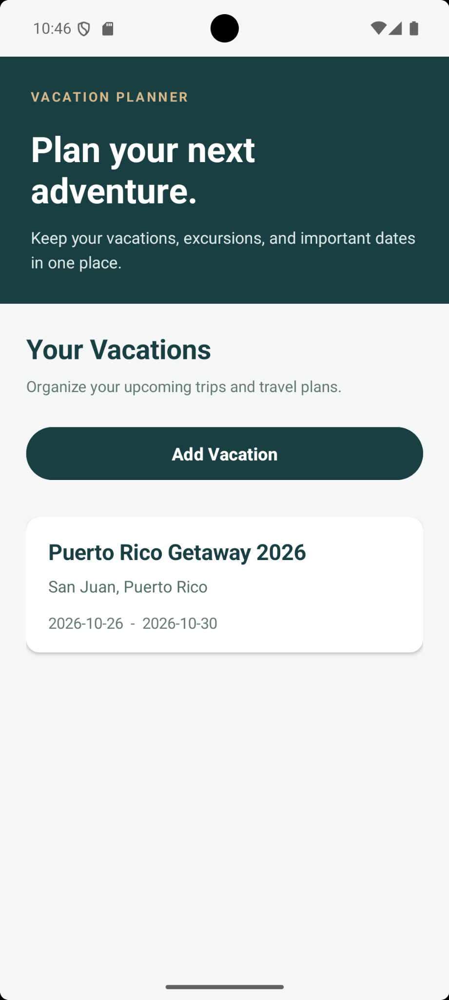
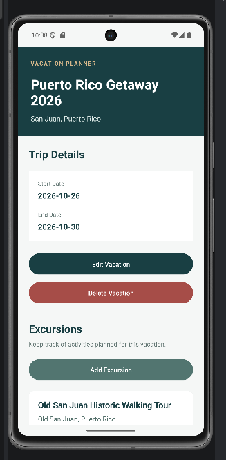
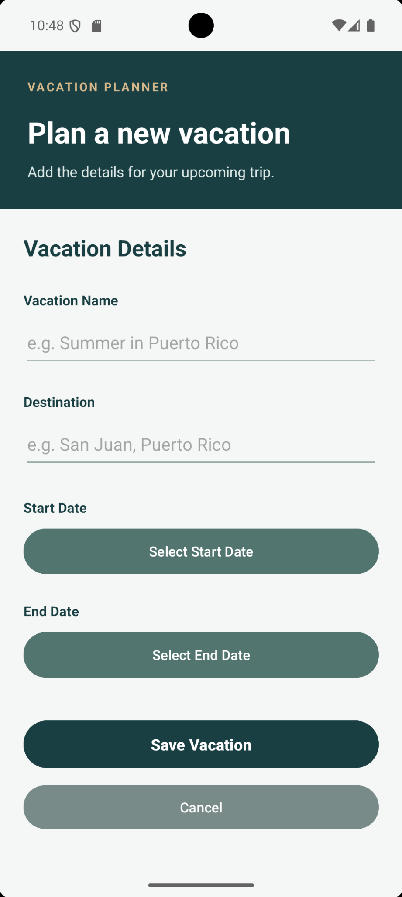
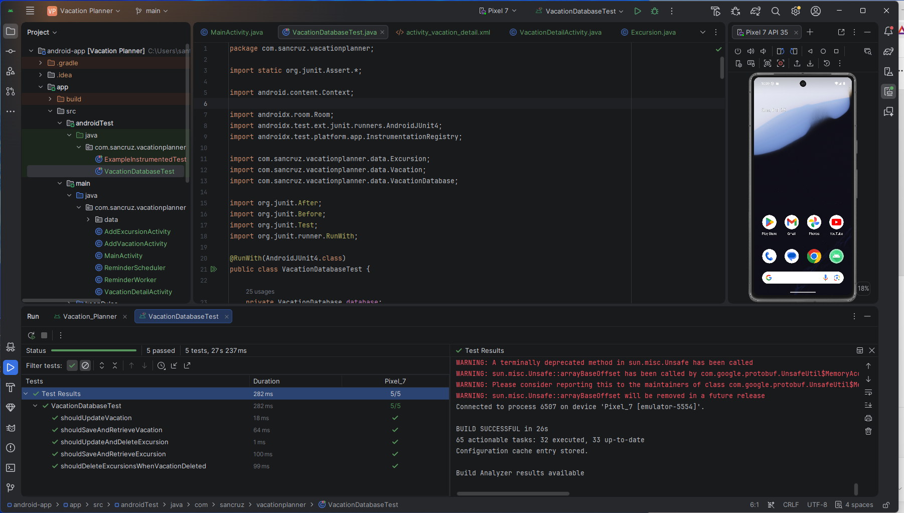

# Android Vacation Planner

A native Android app I built with Java to organize vacations, plan excursions, and keep track of important dates. It uses Room for local data storage and WorkManager for reminders.

## Screenshots

| Home screen | Vacation details | Add vacation |
|:---:|:---:|:---:|
|  |  |  |

## Features

- Create, view, edit, and delete vacations with destinations and travel dates.
- Add and manage excursions linked to a specific vacation.
- Validate vacation date ranges and ensure excursion dates fall within the trip.
- Save vacations and excursions locally using Room (SQLite).
- Schedule vacation and excursion notifications with WorkManager.
- Confirm deletions and automatically delete associated excursions when a vacation is removed.

## Tech Stack

- **Language:** Java
- **Interface:** Android SDK and XML layouts
- **Database:** Room (SQLite)
- **Background tasks:** Android WorkManager
- **Build:** Gradle
- **Testing:** JUnit and AndroidX Test

## Automated Tests

Five instrumented database tests passed on a Pixel 7 emulator running Android API 35:

1. Save and retrieve a vacation.
2. Update a vacation.
3. Save and retrieve an excursion.
4. Update and delete an excursion.
5. Verify excursions are deleted when their vacation is deleted.

## Run Locally

1. Clone this repository.
2. Open the `android-app` folder in Android Studio.
3. Let Gradle finish syncing.
4. Select an emulator or Android device running API 26 or later.
5. Run the app and grant notification permission if prompted.

## Notes

Vacation and excursion information stays on the device; there is no account system or cloud synchronization. WorkManager schedules reminders in the background, but Android may adjust the exact delivery time.
